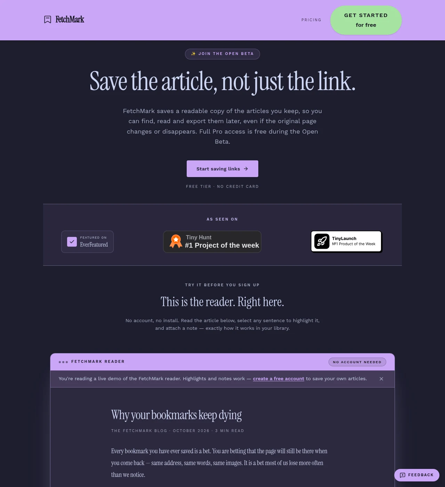
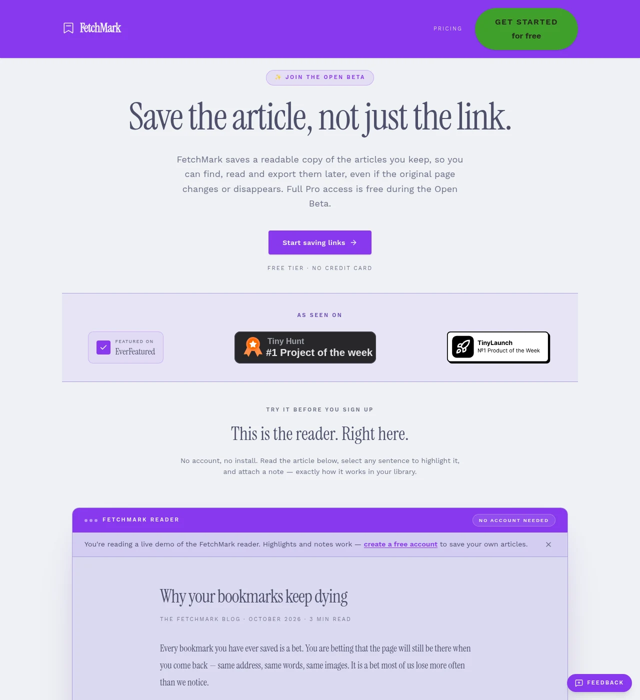
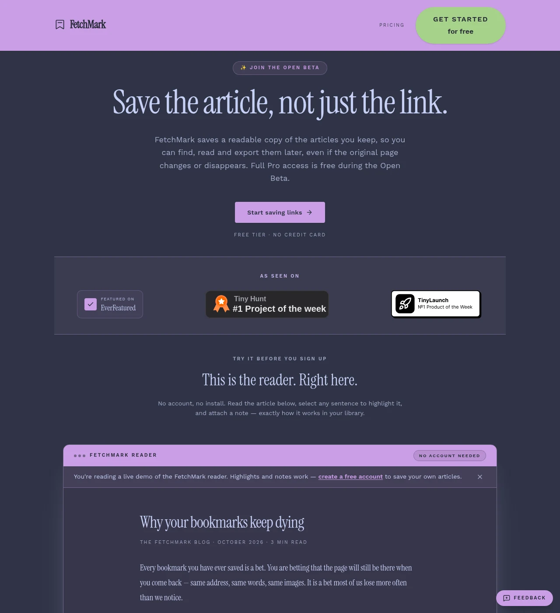
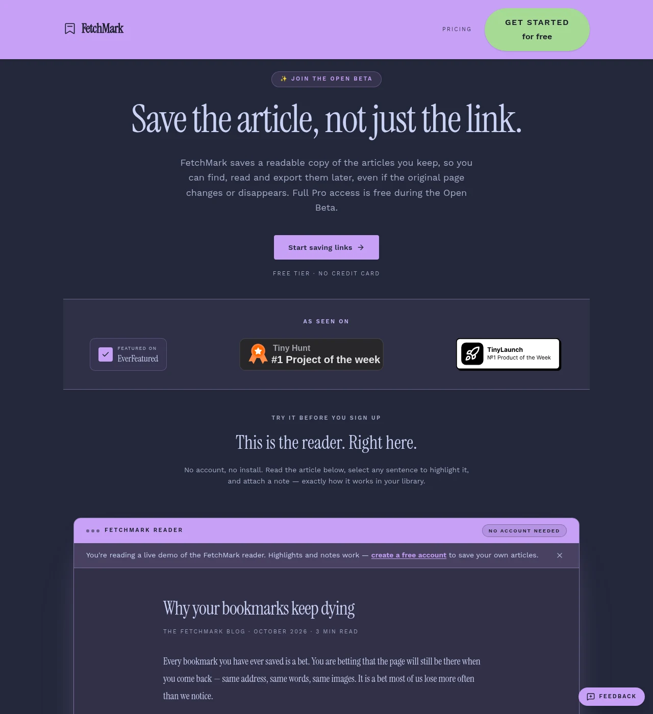

<h3 align="center">
   
  
  Catppuccin for <b>FetchMark</b>
  
</h3>

  
  
  

  

## Colour Palette

🌻 Latte

| Role | Hex | | Role | Hex |
|------|-----|---|------|-----|
| rosewater | `#DC8A78` | | lavender | `#7287FD` |
| flamingo | `#DD7878` | | text | `#4C4F69` |
| pink | `#EA76CB` | | subtext1 | `#5C5F77` |
| mauve | `#8839EF` | | subtext0 | `#6C6F85` |
| red | `#D20D39` | | overlay2 | `#7C7F93` |
| maroon | `#E64553` | | overlay1 | `#8C8FA1` |
| peach | `#FE640C` | | overlay0 | `#9CA0B0` |
| yellow | `#DF8E1E` | | surface2 | `#ACB0BE` |
| green | `#40A02B` | | surface1 | `#BCC0CC` |
| teal | `#179299` | | surface0 | `#CCD0DA` |
| sky | `#03A5E5` | | base | `#EFF1F5` |
| sapphire | `#1F9FB5` | | mantle | `#E6E9EF` |
| blue | `#1E66F5` | | crust | `#DCE0E8` |

🪴 Frappé

| Role | Hex | | Role | Hex |
|------|-----|---|------|-----|
| rosewater | `#F2D5CF` | | lavender | `#BABBF1` |
| flamingo | `#EEBEBE` | | text | `#C6D0F5` |
| pink | `#F4B8E4` | | subtext1 | `#B5BFE2` |
| mauve | `#CA9EE6` | | subtext0 | `#A5ADCE` |
| red | `#E78284` | | overlay2 | `#949CBB` |
| maroon | `#EA999C` | | overlay1 | `#838BA7` |
| peach | `#EF9F76` | | overlay0 | `#737994` |
| yellow | `#E5C890` | | surface2 | `#626880` |
| green | `#A6D189` | | surface1 | `#51576D` |
| teal | `#81C8BE` | | surface0 | `#414559` |
| sky | `#99D1DB` | | base | `#303446` |
| sapphire | `#85C1DC` | | mantle | `#292C3C` |
| blue | `#8CAAEE` | | crust | `#232634` |

🌺 Macchiato

| Role | Hex | | Role | Hex |
|------|-----|---|------|-----|
| rosewater | `#F4DBD6` | | lavender | `#B7BDF8` |
| flamingo | `#F0C6C6` | | text | `#CAD3F5` |
| pink | `#F5BDE6` | | subtext1 | `#B8C0E0` |
| mauve | `#C6A0F6` | | subtext0 | `#A5ADCB` |
| red | `#ED8796` | | overlay2 | `#939AB7` |
| maroon | `#EE99A0` | | overlay1 | `#8087A2` |
| peach | `#F5A97F` | | overlay0 | `#6E738D` |
| yellow | `#EED49F` | | surface2 | `#5B6078` |
| green | `#A6DA95` | | surface1 | `#494D64` |
| teal | `#8AD5CA` | | surface0 | `#363A4F` |
| sky | `#91D7E3` | | base | `#24273A` |
| sapphire | `#7DC4E4` | | mantle | `#1E2030` |
| blue | `#8AADF4` | | crust | `#181926` |

🌿 Mocha

| Role | Hex | | Role | Hex |
|------|-----|---|------|-----|
| rosewater | `#F5E0DC` | | lavender | `#B4BEFE` |
| flamingo | `#F2CDCD` | | text | `#CDD6F4` |
| pink | `#F5C2E7` | | subtext1 | `#BAC2DE` |
| mauve | `#CBA6F7` | | subtext0 | `#A6ADC8` |
| red | `#F38BA8` | | overlay2 | `#9399B2` |
| maroon | `#EBA0AC` | | overlay1 | `#7F849C` |
| peach | `#FAB387` | | overlay0 | `#6C7086` |
| yellow | `#F9E2AF` | | surface2 | `#585B70` |
| green | `#A6E3A1` | | surface1 | `#45475A` |
| teal | `#94E2D5` | | surface0 | `#313244` |
| sky | `#89DCEB` | | base | `#1E1E2E` |
| sapphire | `#75C7EC` | | mantle | `#181825` |
| blue | `#89B4FA` | | crust | `#11111B` |

## Usage

1. Open [FetchMark](https://fetchmarkapp.com) and sign in.
2. Go to **Settings → Appearance**.
3. Under **Catppuccin**, choose **Latte**, **Frappé**, **Macchiato** or **Mocha**.

The choice is stored in your browser and applied on every page, including the reader
and the offline library. The three dark flavours also switch the app into dark mode;
Latte stays light.

### What gets themed

Every surface, border, accent and state colour in the app is driven by semantic tokens,
so a flavour changes the whole interface rather than a single panel.

| App token | Palette role |
|-----------|--------------|
| Background | `base` |
| Panel surface | `mantle` |
| Card / raised surface | `surface0` |
| Input surface | `surface1` |
| Borders, dividers, rings | `surface2` |
| Primary text | `text` |
| Secondary text, muted labels | `subtext1`, `subtext0` |
| Icons, placeholders, disabled text | `overlay1`, `overlay0` |
| Brand, links, primary buttons | `mauve` |
| Secondary buttons | `lavender` |
| Destructive actions, unread counts | `red` |
| Success and "saved" states | `green` |
| Warning and pending states | `yellow`, `peach` |
| Footer surface | `crust` (Latte: `text`, since its crust is pale) |
| Sidebar surface | `mantle` |

The full token layer is published in
[`fetchmark-catppuccin.css`](./fetchmark-catppuccin.css), which is the same CSS the
production app loads.

### Screenshots

| Latte | Frappé |
|-------|--------|
|  |  |

| Macchiato | Mocha |
|-----------|-------|
|  |  |

### Notes

- Press and directory badges in the footer are other organisations' artwork and keep
  their own brand colours.
- Contrast was checked per flavour for the primary button, its label, the footer text
  and the social-proof band (all ≥ 4.5:1, WCAG AA).

## 💫 Thanks to

- [Lugwiire-Benard](https://github.com/Lugwiire-Benard) (maintainer)

## 🙌 Relevant projects

- [FetchMark](https://fetchmarkapp.com) — save the full article, not just the link.

## Acknowledgement

